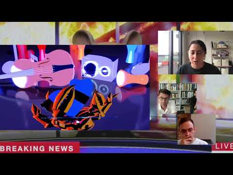
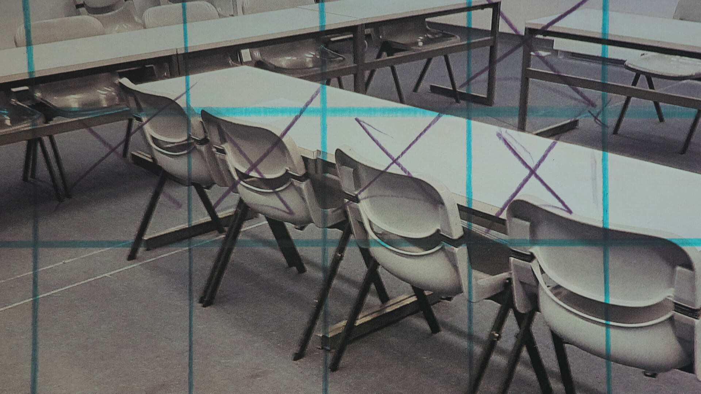

# Sturm&Drang / Sturm&Drang Studio

**Tag tecnica/formato:** `modellazione-3d` `game-engine-realtime` `installazione`
**Tag tema:** `storia-computer-grafica` `economia-attenzione`
**Tag corso:** `TAD-DCV` `AW` `M3D`
**Stato:** non è uno studio di produzione CGI commerciale ma un progetto curatoriale ed educativo (Fondazione Prada × ETH Zürich) · da non confondere con sturm@drang GmbH (Augusta)

## Biografia
⚠️ Nota preliminare importante: "Sturm&Drang" e "Sturm&Drang Studio" **non sono uno studio di produzione CGI commerciale**, come inizialmente ipotizzato nella traccia di ricerca, bensì un **progetto curatoriale ed educativo**, nato dalla collaborazione fra **Fondazione Prada** (Milano) e **gta exhibitions**, dipartimento di Architettura del **ETH Zürich**. Curato da **Luigi Alberto Cippini** (Armature Globale), **Fredi Fischli** e **Niels Olsen** (gta exhibitions, ETH Zürich), il progetto indaga le pratiche, le esperienze e gli ambienti della computer-generated imagery (CGI).

La prima fase del progetto è **"Sturm&Drang Studio"**, un corso universitario online rivolto a 185 studenti dell'ETH Zürich, tenuto dagli stessi curatori-tutor (Cippini, Fischli, Olsen), lanciato il 22 febbraio 2021 nell'ambito dell'insegnamento "History of Art and Architecture: Exhibiting Architecture". L'obiettivo dichiarato del corso è far immergere gli studenti nelle dinamiche dell'industria digitale, imitandone componenti e flussi di lavoro, allontanandosi dall'approccio didattico tradizionale universitario, con l'intento di sviluppare un'analisi critica dell'infrastruttura dell'industria digitale stessa.

La seconda fase, **"Sturm&Drang"**, comprende una serie di conversazioni online (a partire dal 7 aprile 2021) e un progetto espositivo negli spazi dell'**Osservatorio Fondazione Prada** a Milano, dal **9 settembre 2021 al 23 gennaio 2022** (alcune fonti secondarie riportano date lievemente diverse, 16 settembre 2021–17 gennaio 2022: la data indicata dal sito ufficiale di Fondazione Prada è quella da considerarsi definitiva), poi ripreso anche negli spazi di gta exhibitions all'ETH Zürich. Il percorso espositivo mette insieme quattro ambienti — citazioni di spazi reali o immaginari — che ospitano il "making of" della programmazione CGI in contesti come videogiochi, fantascienza e ingegneria high-tech.

⚠️ Da non confondere: esiste una società di comunicazione/marketing tedesca completamente estranea, **sturm@drang GmbH** (fondata nel 1999 ad Augsburgo, Germania, gestita da Pius Benedikt Horber, tagline "Lucky You!"), che non ha alcuna relazione con il progetto curatoriale qui trattato.

## Poetica e ricerca
Il progetto esplora le applicazioni, le esperienze e gli ambienti legati alla computer-generated imagery con l'obiettivo dichiarato di rivelare la complessità della modellazione al computer e di analizzare la produzione contemporanea di immagini e il suo impatto sulla percezione quotidiana. Il titolo — ripreso dal movimento letterario tedesco del tardo Settecento "Sturm und Drang" ("tempesta e impeto"), incentrato su intensità emotiva e soggettività — viene qui traslato sulla produzione CGI contemporanea, suggerendo un parallelo fra l'intensità espressiva romantica e l'iperproduzione algoritmica di immagini dell'industria digitale odierna. Il format del corso universitario che imita i flussi di lavoro dell'industria (piuttosto che insegnarli in modo tradizionale) rappresenta un approccio pedagogico distintivo: gli studenti non studiano la CGI dall'esterno, ma la praticano dall'interno per poterla poi analizzare criticamente.

## Opere principali
### Sturm&Drang Studio, corso online ETH Zürich (2021)
**Descrizione:** corso universitario online per 185 studenti, lanciato il 22 febbraio 2021, che imita componenti e flussi di lavoro dell'industria digitale della CGI.
**Lettura critica:** prima fase del progetto complessivo — un esperimento pedagogico che rovescia il rapporto fra teoria e pratica, facendo della simulazione del lavoro industriale lo strumento stesso di critica dell'industria.

### Sturm&Drang, mostra all'Osservatorio Fondazione Prada (9 settembre 2021–23 gennaio 2022)
**Descrizione:** mostra articolata in quattro ambienti tematici che ricostruiscono il "making of" della produzione CGI in ambiti quali videogiochi, fantascienza e ingegneria high-tech, preceduta da una serie di conversazioni online a partire dal 7 aprile 2021. Tra i partecipanti/collaboratori documentati: Markus Gross (VP di Disney Research Studios), ArtefactoryLab (già presente in questo database), l'artista Meriem Bennani, Sybil Montet, Sara Sadik, Emanuel Rossetti.
**Lettura critica:** *STIRworld* descrive la mostra come capace di "smontare i dentro e fuori della CGI"; il progetto si distingue per la scelta di rendere visibile l'infrastruttura tecnica e produttiva dell'immagine digitale, di solito invisibile allo spettatore finale.
**Video:** [YouTube — "Sturm&Drang Studio | Meriem Bennani"](https://www.youtube.com/watch?v=HCAnRGvSKSw)

**Approfondimento:** [STIRworld — "'Sturm & Drang' exhibition at Prada's Milan Osservatorio unpacks ins and outs of CGI"](https://www.stirworld.com/see-features-sturm-drang-exhibition-at-pradas-milan-osservatorio-unpacks-ins-and-outs-of-cgi)

## Interviste e talk
- _Nessuna ancora: da aggiungere._

## Fonti
- [Fondazione Prada — pagina progetto "Sturm&Drang"](https://www.fondazioneprada.org/project/sturmdrang-ita/?lang=en)
- [Fondazione Prada — pagina progetto "Sturm&Drang Studio"](https://www.fondazioneprada.org/project/sturmdrang-studio/?lang=en)
- [STIRworld — "'Sturm & Drang' exhibition at Prada's Milan Osservatorio unpacks ins and outs of CGI"](https://www.stirworld.com/see-features-sturm-drang-exhibition-at-pradas-milan-osservatorio-unpacks-ins-and-outs-of-cgi)
- [Collater.al — "'Sturm&Drang', Prada presenta un nuovo progetto espositivo"](https://www.collater.al/en/sturm-drang-cgi-fondazione-prada-art/)
- [Domus — "At the Prada Foundation Observatory an exhibition dedicated to the digital image"](https://www.domusweb.it/en/speciali/breraz/gallery/2021/at-the-prada-foundation-observatory-an-exhibition-dedicated-to-the-digital-image.html)
- [Exibart — "Computer-generated imagery: le masterclass di Fondazione Prada e ETH Zurich"](https://www.exibart.com/progetti-e-iniziative/computer-generated-imagery-le-masterclass-di-fondazione-prada-e-eth-zurich/)
- [ZOE Magazine — "Osservatorio Fondazione Prada presents Sturm&Drang"](https://www.zoemagazine.net/177795-osservatorio-fondazione-prada-presents-sturmdrang/)
- [YouTube — "Sturm&Drang Studio | Meriem Bennani"](https://www.youtube.com/watch?v=HCAnRGvSKSw)

## Crediti delle immagini
Immagine per ciascuna delle due opere, inclusa sotto la relativa descrizione in "Opere principali", da un fotogramma YouTube e da STIRworld. Il sito ufficiale di Fondazione Prada blocca sistematicamente ogni tentativo di accesso automatico (HTTP 403), in tutte le tecniche provate in questa sessione.
- [Fondazione Prada — pagina progetto "Sturm&Drang"](https://www.fondazioneprada.org/project/sturmdrang-ita/?lang=en)
- [Fondazione Prada — pagina progetto "Sturm&Drang Studio"](https://www.fondazioneprada.org/project/sturmdrang-studio/?lang=en)
- [STIRworld — "'Sturm & Drang' exhibition at Prada's Milan Osservatorio unpacks ins and outs of CGI"](https://www.stirworld.com/see-features-sturm-drang-exhibition-at-pradas-milan-osservatorio-unpacks-ins-and-outs-of-cgi)
