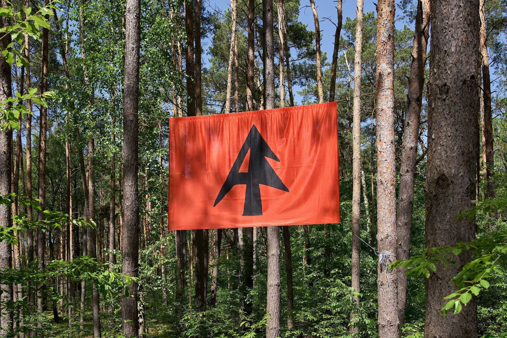

# terra0 (Paul Kolling & Paul Seidler)

**Tag tecnica/formato:** `installazione` `procedurale-generativo`
**Tag tema:** `ecologia-ambiente` `intelligenza-artificiale-critica`
**Stato:** fonte unica finora: il testo di sala della mostra «Strange Rules» (Palazzo Diedo, Venezia, 2026)

## Biografia
Collettivo tedesco fondato nel 2015 da Paul Kolling (n. 1993, Germania) e Paul Seidler (n. 1988, Germania).

## Poetica e ricerca
terra0 esplora dal 2015 come gli ecosistemi naturali possano diventare agenti economici autonomi, interrogandosi sulle possibilità di proprietà collettiva e autogestione tramite tecnologie decentralizzate (blockchain, DAO — organizzazioni autonome decentralizzate). Il lavoro si colloca consapevolmente nella tradizione della critica istituzionale e della land art: non produce oggetti da vendere, ma protocolli — sistemi di componenti tecniche, economiche ed ecologiche capaci di esistere e operare indipendentemente dalle istituzioni artistiche.

## Opere principali
### Autonomous Forest (2025-in corso)
**Descrizione:** progetto di land art "processuale" che sottrae una foresta allo sfruttamento economico trasformando la proprietà in una forma collettiva, democratica e mediata dalla tecnologia. Situata a 120 km da Berlino, la prima area di 3.000 m² è gestita da un'associazione no-profit la cui governance passa attraverso una DAO basata su blockchain: le decisioni sulla gestione forestale vengono prese dai membri tramite piattaforme digitali decentralizzate, senza autorità centrale. L'installazione in mostra presenta sedie prive di proprietario, non rivendicate, insieme alla documentazione del progetto (non un oggetto fisico, ma appunto un protocollo).
**Lettura critica:** le sedie vuote simboleggiano la partecipazione democratica e la posta in gioco — un segnaposto per il "soggetto parlante" sempre disponibile, sempre vacante; ma portano anche un'ambiguità inquietante: se le strutture legali e algoritmiche agiscono sempre di più da sole, e nessuno si siede, chi prende davvero il controllo? (Testo di sala, mostra "Strange Rules", Palazzo Diedo, Venezia.)

**Approfondimento:** [autonomousforest.org](https://autonomousforest.org/)

## Interviste e talk
- _Nessuna ancora: da aggiungere._

## Fonti
- [autonomousforest.org](https://autonomousforest.org/)
- Testo di sala, "Strange Rules", Palazzo Diedo, Venezia (foto scattata dal docente, 9 agosto 2026)

## Mostre viste
- *Strange Rules*, Palazzo Diedo, Venezia (2026) — visto da @danMa-hub

## Crediti delle immagini
Immagine dell'unica opera documentata, inclusa sotto la relativa descrizione in "Opere principali", dal sito ufficiale del progetto.
- [autonomousforest.org](https://autonomousforest.org/)
