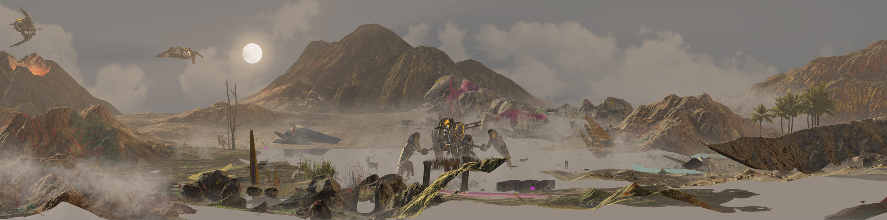
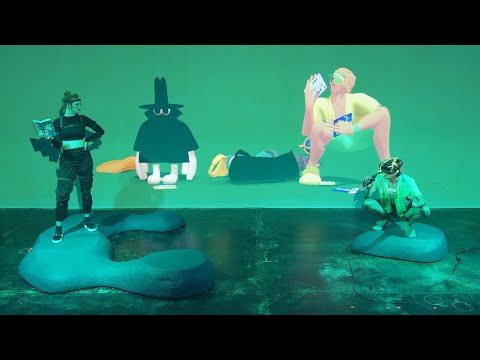
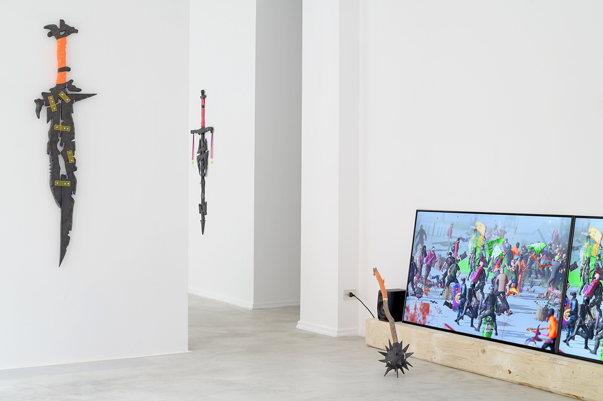
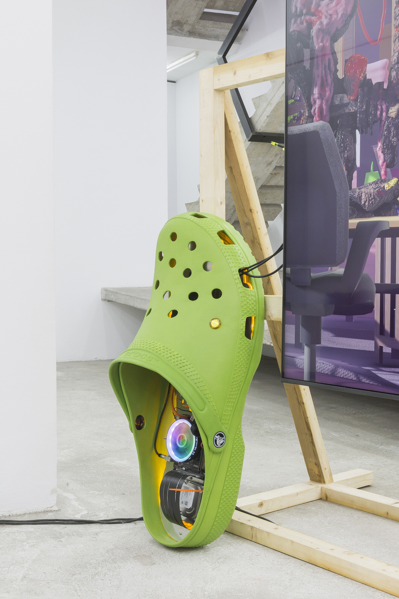
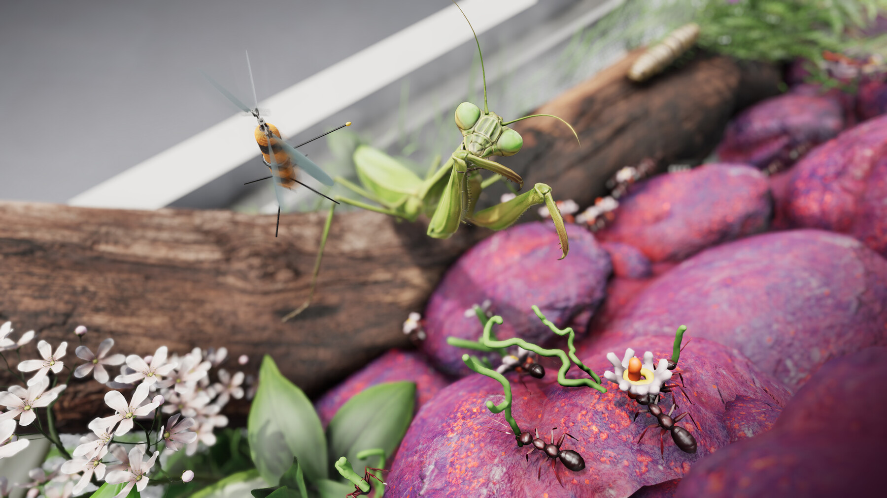
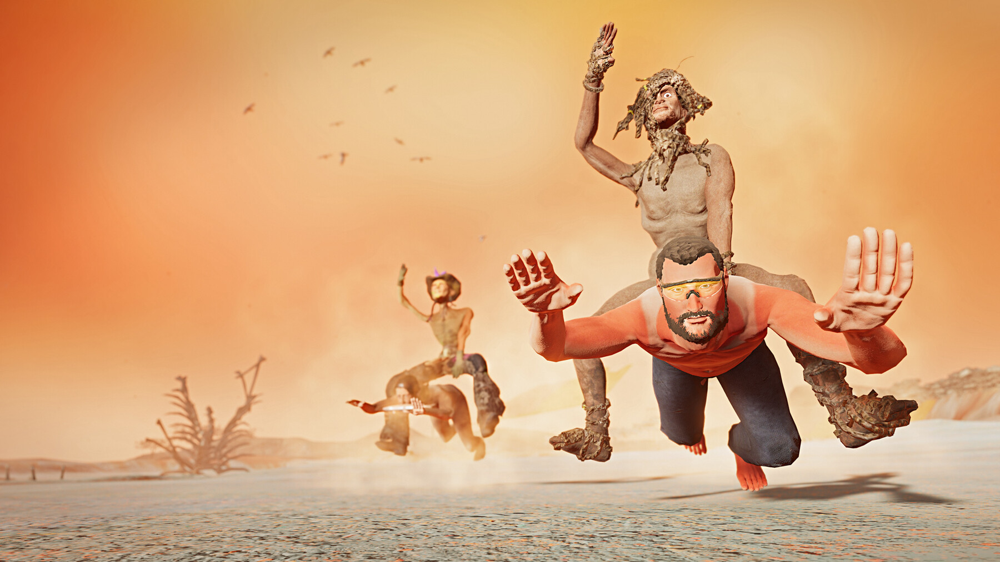

# Theo Triantafyllidis

**Tag tecnica/formato:** `game-engine-realtime` `modellazione-3d` `intelligenza-artificiale-generativa` `installazione`
**Tag tema:** `mondi-virtuali-simulazione` `corpo-identita` `game-culture`
**Tag corso:** `TAD-DCV` `AW` `M3D`

## Biografia
Nato nel 1988 ad Atene, Grecia. Consegue il diploma in architettura al National Technical University of Athens (circa 2012) e un MFA in Design Media Arts alla UCLA (2016), dove in seguito ha anche insegnato come lecturer. Vive e lavora a Los Angeles, con base anche ad Atene. Si forma come architetto e cresce artisticamente accanto ai collettivi di net art post-internet e alla prima cultura Tumblr/meme, per poi spostarsi verso i motori di gioco real-time e l'arte della simulazione dopo l'MFA. Il Whitney Museum of American Art possiede due sue opere in collezione permanente: *Seamless* (2017) e *BugSim (Pheromone Spa)* (2023). Nel 2026 è il primo vincitore del Frieze London Artist Award, assegnato in collaborazione con Google Arts & Culture e prodotto con Forma, con l'opera *Feral Metaverse (Spider)*, presentata a Frieze London (The Regent's Park, 14-18 ottobre 2026). Rappresentato da The Breeder (Atene), Meredith Rosen Gallery (New York), Eduardo Secci/SECCI (Firenze e Milano) e Galerie Julien Cadet (Parigi).

⚠️ Nota: non risulta alcuna rappresentanza presso le gallerie Emalin (Londra) o Bel Ami (Los Angeles), talvolta citate in fonti secondarie non verificate.

## Poetica e ricerca
Triantafyllidis costruisce "simulazioni dal vivo" — ambienti software immersivi, automatizzati o interattivi, adattabili a VR/AR/installazione video — che usa sia per narrare criticamente le conseguenze sociali e psicologiche della tecnologia della comunicazione, sia per costruire mondi-ecosistema alternativi ed evolutivi in autonomia. Il critico e curatore Domenico Quaranta, tra le voci più autorevoli sull'arte post-internet e dei nuovi media, gli ha dedicato due interventi critici: il saggio "Live Simulation" (commissionato da Fabbula in collaborazione con la Zabludowicz Collection per la mostra "Among the Machines") e la mostra personale "Sisyphean Cycles" (2023, Spazio Vitale, Verona), da lui curata, che riunisce quattro simulazioni dal vivo in un unico percorso narrativo attraverso mondi-ecosistema capaci di automodificarsi. Kim Conaty, curatrice capo della famiglia Crown al Whitney Museum, ha dichiarato: "L'approccio di Theo a umorismo, assurdo e perturbante conferisce ai suoi ambienti immersivi un margine poetico avvincente." L'artista stesso descrive il proprio interesse come rivolto "alla tensione tra le nostre vite addomesticate e iperconnesse e gli istinti primordiali che continuano a guidare gran parte del nostro comportamento", e a proposito dell'IA generativa: "Sto iniziando a vedere questo contenuto generato dall'IA come un materiale strano e malleabile, molto parte della nostra epoca." La ricerca attraversa la "teoria del mostro" per indagare isolamento, sessualità e violenza, proponendo umorismo computazionale e improvvisazione IA come risposta all'agenda dell'industria tecnologica. *Radicalization Pipeline* (2021) viene letta dalla critica come un'analisi diretta di QAnon, dell'assalto al Campidoglio del 6 gennaio, della gamificazione dell'estremismo e dell'iconografia della mascolinità tossica.

## Opere principali
### Seamless (2017)
**Corso:** `AW`
**Temi:** `vita-artificiale-e-simulazione`
**Descrizione:** simulazione dal vivo, colore e sonoro, durata infinita, dimensioni variabili. Acquisita dal Whitney Museum of American Art (fondi del Digital Art Committee e di Keith Grossman).
**Lettura critica:** una delle prime opere dell'artista a entrare in una collezione museale permanente statunitense — segna il riconoscimento istituzionale precoce della "simulazione dal vivo" come formato artistico a sé stante, non riducibile al videogioco o al video.

**Approfondimento:** [Whitney Museum — Seamless](https://whitney.org/collection/works/67918)

### Anti-Gone (2019/2020)
**Corso:** `AW`
**Temi:** `performance-audiovisiva`
**Descrizione:** performance/simulazione in realtà mista, con i collaboratori Connor Willumsen (anche autore del fumetto di riferimento) e Matthew Doyle. Ambientata in un mondo post-collasso climatico, dove città sommerse ospitano ancora i resti della cultura consumistica tardo-capitalista; due personaggi, Spyda e Lynxa, si muovono "senza attrito" tra shopping, cinema e psichedelici. Adatta le meccaniche dei videogiochi open-world a una simulazione 3D continua in tempo reale combinata con performance dal vivo. Commissionata e prodotta da Onassis Culture; anteprima completa al Sundance Film Festival New Frontier 2020 (curato da Shari Frilot).
**Lettura critica:** una delle prime opere a portare le meccaniche del mondo aperto videoludico in un contesto di performance dal vivo con pubblico presente — la simulazione non è solo osservata ma abitata in tempo reale insieme ai performer.

### Radicalization Pipeline (2021)
**Corso:** `AW`
**Temi:** `propaganda-e-media`
**Descrizione:** simulazione dal vivo in forma di "battle royale" ispirata ai giochi di ruolo, in cui furry, creature fantastiche, cripto-anarchici e "insurrezionisti del capitale" combattono in una rissa generale ultra-violenta mentre sprofondano in un paesaggio fangoso, intervallata da cover in stile medievale di canzoni pop. Legge esplicitamente le connessioni tra gamificazione, fantasia delle sottoculture online e radicalizzazione politica reale, con riferimenti diretti a QAnon e all'assalto al Campidoglio del 6 gennaio, e alla struttura a "imbuto" delle camere d'eco social. Accompagnata da sculture in ceramica raffiguranti armi, con titoli come "Chadslayer", "Snowflake Skorcher" e "Stormbringer". Mostra personale/evento dal vivo da Eduardo Secci, Milano.
**Lettura critica:** l'opera più esplicitamente politica dell'artista — trasforma il linguaggio ludico e memetico dell'estremismo online in un'esperienza immersiva che ne rende visibile, senza attenuarla, la logica di gamificazione.
**Video:** [Radicalization Pipeline, documentazione (YouTube)](https://www.youtube.com/watch?v=QYirwYYhfEc)

### Ork Haus (2022)
**Corso:** `AW`
**Temi:** `avatar-e-corpo-virtuale`
**Descrizione:** simulazione dal vivo su schermo 4K e PC da gaming, con performance in motion capture di Rachel Ho e musica di Daniel Burley e Gobby. Immerge lo spettatore nella vita domestica di una famiglia di orchi la cui esistenza è interamente condizionata dalla tecnologia digitale, che fugge in videogiochi, VR e livestreaming — descritta come un ibrido tra *The Sims* e il teatro sperimentale di Lars von Trier (*Dogville*). Lo spettatore può osservare passivamente o manipolare attivamente la simulazione.
**Lettura critica:** applica la logica della simulazione domestica non a un futuro speculativo ma a un presente immediatamente riconoscibile — la famiglia di mostri è, nella sostanza, una famiglia contemporanea qualsiasi.

### BugSim (Pheromone Spa) (2023)
**Corso:** `AW` `M3D`
**Temi:** `vita-artificiale-e-simulazione`
**Descrizione:** simulazione software dal vivo su sei schermi (due file orizzontali di tre), che raffigura un surreale terrario microscopico: formiche che costruiscono strutture, una foresta in crescita di minuscole piante fiorite, repliche di api, una lumaca, uno scarabeo stercorario, una "mantide tempesta" e un "ragno zucchero". Installazione olfattiva di accompagnamento realizzata con l'artista di profumi Labrilena Konstantelou. Acquisita dal Whitney Museum (fondi del Digital Art Committee); prima mostra personale, "Pheromone Spa", da The Breeder, Atene.
**Lettura critica:** sposta la simulazione dal vivo dalla scala umana a quella microscopica — un ecosistema di insetti come sistema autonomo che continua a evolvere indipendentemente dalla presenza dello spettatore, con il coinvolgimento insolito dell'olfatto oltre a vista e udito.
**Video:** [BugSim (Pheromone Spa), documentazione (YouTube, Whitney Museum)](https://www.youtube.com/watch?v=EIfFZRD3s2A)

**Approfondimento:** [Whitney Museum — BugSim (Pheromone Spa)](https://whitney.org/collection/works/67919)

### Feral Metaverse (serie, 2023-2026, culminata in Feral Metaverse (Spider), 2026)
**Corso:** `AW`
**Temi:** `avatar-e-corpo-virtuale`
**Descrizione:** videogioco multiplayer online che rifiuta l'estetica da "metaverso" della Silicon Valley in favore di qualcosa di "tattile, goffo e divertente", dove i giocatori sopravvivono solo attraverso cooperazione e gentilezza; nessun testo o parola è previsto, il che costringe i giocatori a inventare forme di comunicazione incarnate e coreografiche. Per il Frieze London Artist Award 2026 (co-commissionato e prodotto con Forma, in collaborazione con Google Arts & Culture), l'artista costruisce una scultura fisica scalabile a forma di ragno che funge da portale verso un ambiente digitale condiviso, dove i giocatori cooperano per formare "corpi di gruppo" (torri, ruote, abbracci collettivi, ragni). Una versione anticipata, *Feral Metaverse: Prologue*, è giocabile su itch.io.
**Lettura critica:** l'opera che porta a compimento, su scala pubblica e istituzionale (una delle fiere d'arte più importanti al mondo), la ricerca dell'artista su cooperazione e comunicazione non verbale come alternativa critica all'individualismo competitivo tipico dei metaversi commerciali.

**Approfondimento:** [Frieze — Frieze London Artist Award 2026](https://www.frieze.com/article/frieze-london-2026-theo-triantafyllidis-artist-award)

## Interviste e talk
- _Nessuna ancora: da aggiungere._

## Fonti
- [slimetech.org — sito ufficiale dell'artista](https://slimetech.org/)
- [Whitney Museum — pagina artista](https://whitney.org/artists/20904)
- [Whitney Museum — Seamless, collezione](https://whitney.org/collection/works/67918)
- [Whitney Museum — BugSim (Pheromone Spa), collezione](https://whitney.org/collection/works/67919)
- [Onassis Foundation — profilo artista](https://www.onassis.org/people/theo-triantafyllidis)
- [Zabludowicz Collection — pagina artista](https://www.zabludowiczcollection.com/collection/artists/view/theo-triantafyllidis)
- [Frieze — Frieze London Artist Award 2026](https://www.frieze.com/article/frieze-london-2026-theo-triantafyllidis-artist-award)
- [Domenico Quaranta — saggio "Live Simulation" (Substack)](https://domenicoquaranta.substack.com/p/theo-triantafyllidis-sisyphean-cycles)
- [Fondazione Spazio Vitale — mostra "Sisyphean Cycles"](https://fondazionespaziovitale.it/en/exhibition/theo-triantafyllidis-sisyphean-cycles/)
- [FACT Magazine — "Theo Triantafyllidis Presents: Radicalization Pipeline"](https://www.factmag.com/2022/04/05/theo-triantafyllidis-presents-radicalization-pipeline/)
- [Galerie Magazine — "Next Big Thing: Theo Triantafyllidis"](https://galeriemagazine.com/next-big-thing-theo-triantafyllidis/)

## Crediti delle immagini
Immagine per ciascuna delle sei opere, inclusa sotto la relativa descrizione in "Opere principali", dal sito ufficiale dell'artista (slimetech.org), dal Whitney Museum e da YouTube.
- [slimetech.org — sito ufficiale dell'artista](https://slimetech.org/)
- [Whitney Museum — pagina artista](https://whitney.org/artists/20904)
- [Whitney Museum — Seamless, collezione](https://whitney.org/collection/works/67918)
