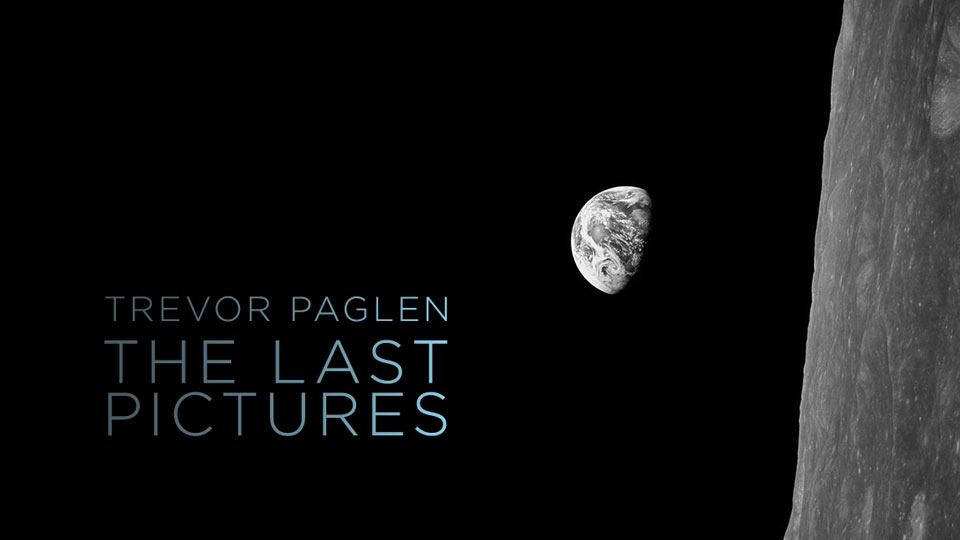
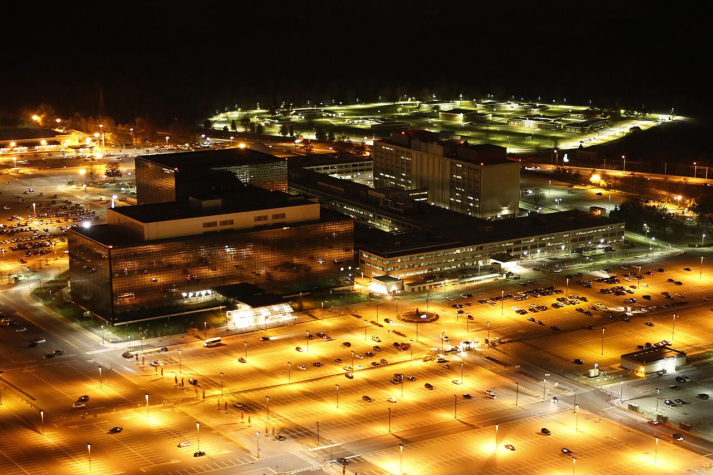
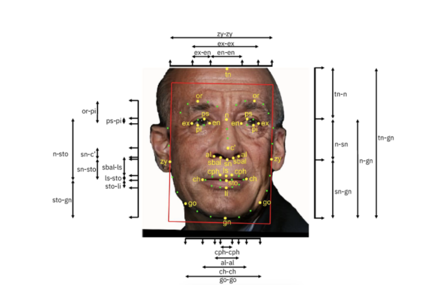

# Trevor Paglen

**Tag tecnica/formato:** `fotografia` `installazione` `data-visualization`
**Tag tema:** `sorveglianza-controllo` `intelligenza-artificiale-critica`

## Biografia
Nato nel 1974 a Camp Springs, Maryland (USA), vive e lavora a Berlino. Formato sia come artista che come geografo (PhD in geografia, UC Berkeley), combina ricerca, giornalismo e tecnologie di imaging avanzate. MacArthur Fellowship 2017; Electronic Frontier Foundation Pioneer Award 2014 per il contributo alla contro-sorveglianza; Deutsche Börse Photography Foundation Prize 2016 ([Ocula](https://ocula.com/artists/trevor-paglen/); [MacArthur Foundation](https://www.macfound.org/fellows/class-of-2017/trevor-paglen)).

## Poetica e ricerca
Paglen indaga i temi della segretezza, del militarismo e della politica della visibilità: le infrastrutture fisiche e planetarie di internet e del capitalismo dei dati, e i modi in cui i sistemi di machine learning ridefiniscono l'immagine e la percezione. Ha coniato — insieme a Kate Crawford, teorica non artista ma spesso co-autrice — analisi critiche del training dei dataset di intelligenza artificiale (progetti come *ImageNet Roulette* ed *Excavating AI*, con Kate Crawford). Ha scritto lui stesso il saggio **"Operational Images"** (e-flux journal #59, 2014) che riprende e sviluppa il concetto di Harun Farocki — le immagini prodotte non per essere guardate ma per essere calcolate, misurate, usate per navigare o colpire un bersaglio — collegando esplicitamente la propria ricerca a quella del regista tedesco.

## Opere principali

### Voyager (2026, Strange Rules, Palazzo Diedo, Venezia; coprodotta con MAAT — Museum of Art, Architecture and Technology, Lisbona)
**Descrizione:** installazione audio interattiva che guida i partecipanti attraverso stati ipnotici, in cabine sensoriali private con sensori per il battito cardiaco e un menu di percorsi audioguidati (misticismo apofatico, deframmentazione neurologica, ipnosi ericksoniana). Caratteristica insolita per un'opera d'arte: non usa alcuna immagine.
**Lettura critica:** scommette che il linguaggio parlato, usato con precisione, possa funzionare come "codice eseguibile" per generare un mondo interiore — le immagini evocate ipnoticamente dall'inconscio del partecipante possono essere più immersive e toccanti di qualunque immagine mostrata direttamente. (Testo di sala, mostra "Strange Rules", Palazzo Diedo, Venezia, visitata 9 agosto 2026.)

⚠️ Nessuna immagine per coerenza con l'opera stessa, che non ne usa alcuna.

### The Last Pictures (2012–)
**Descrizione:** un disco di 100 immagini micro-incise, racchiuso in un guscio dorato, lanciato in orbita geostazionaria a bordo di un satellite per le telecomunicazioni — un archivio speculativo per spettatori futuri, ispirato alle pitture rupestri, ai segnali di avvertimento delle scorie nucleari e ai Golden Records di Carl Sagan.
**Lettura critica:** riflette sulla durata (le orbite geostazionarie possono restare stabili per miliardi di anni) e su cosa scegliere di comunicare a un futuro remoto e sconosciuto.

**Approfondimento:** [Creative Time — The Last Pictures](https://creativetime.org/projects/the-last-pictures/)

### Limit Telephotography / Blank Spots on the Map: The Dark Geography of the Pentagon's Secret World (2009, libro + serie fotografica)
**Descrizione:** immagini composite catturate con teleobiettivi lunghi fino a un miglio, che rivelano droni e "siti neri" (basi militari classificate, strutture di detenzione, società di facciata della CIA) altrimenti invisibili.
**Lettura critica:** rende visibile — letteralmente, tramite la tecnica fotografica — l'architettura nascosta del potere statale contemporaneo.

### ImageNet Roulette / Excavating AI (2019, con Kate Crawford)
**Descrizione:** progetto critico (sito web interattivo + saggio) che espone i bias razzisti, sessisti e classisti incorporati nei dataset di training usati per addestrare sistemi di visione artificiale, in particolare ImageNet.
**Lettura critica:** mostra come l'intelligenza artificiale non sia neutra: classifica il mondo secondo le categorie — spesso pregiudiziali — di chi ha costruito il dataset.

**Approfondimento:** [excavating.ai — saggio integrale](https://www.excavating.ai/)

## Immagini

Immagine per tre delle quattro opere, inclusa sotto la relativa descrizione in "Opere principali", da Creative Time, Wikimedia Commons ed excavating.ai. Nessuna immagine per *Voyager*, opera che non ne usa alcuna per propria natura.
- [paglen.com](https://paglen.com/)
- [Ocula — biografia](https://ocula.com/artists/trevor-paglen/)
- [MacArthur Foundation — Trevor Paglen](https://www.macfound.org/fellows/class-of-2017/trevor-paglen)

## Fonti
- [paglen.com](https://paglen.com/) (sito ufficiale, da verificare url esatto)
- [Ocula — biografia](https://ocula.com/artists/trevor-paglen/)
- [MacArthur Foundation — Trevor Paglen](https://www.macfound.org/fellows/class-of-2017/trevor-paglen)
- [Pace Gallery — pagina artista](https://www.pacegallery.com/artists/trevor-paglen/)
- [Trevor Paglen — "Operational Images" (e-flux journal #59)](https://www.e-flux.com/journal/59/61130/operational-images/)
- Testo di sala, "Strange Rules", Palazzo Diedo, Venezia (foto scattata dal docente, 9 agosto 2026)

---

## Appunti da organizzare
- Fonte: testo di sala fotografato dal vivo alla mostra "Strange Rules" (Palazzo Diedo, Venezia, 9 agosto 2026, curata da Obrist/Dryhurst/Herndon) + ricerca diretta per biografia e opere storiche.
- Collegamento diretto a **Harun Farocki** (già in database) sul concetto di "immagini operative" — Paglen ha scritto lui stesso il saggio omonimo citato nella scheda di Farocki.
- Sito ufficiale da verificare (non individuato con certezza in questa sessione).
