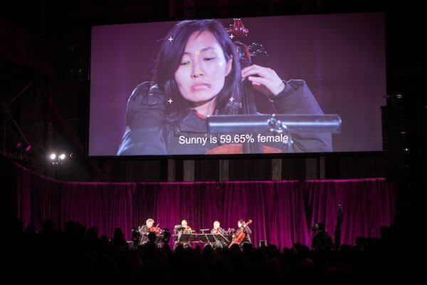
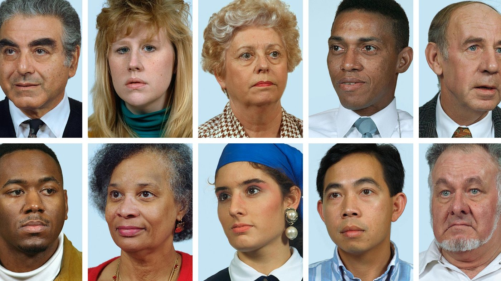
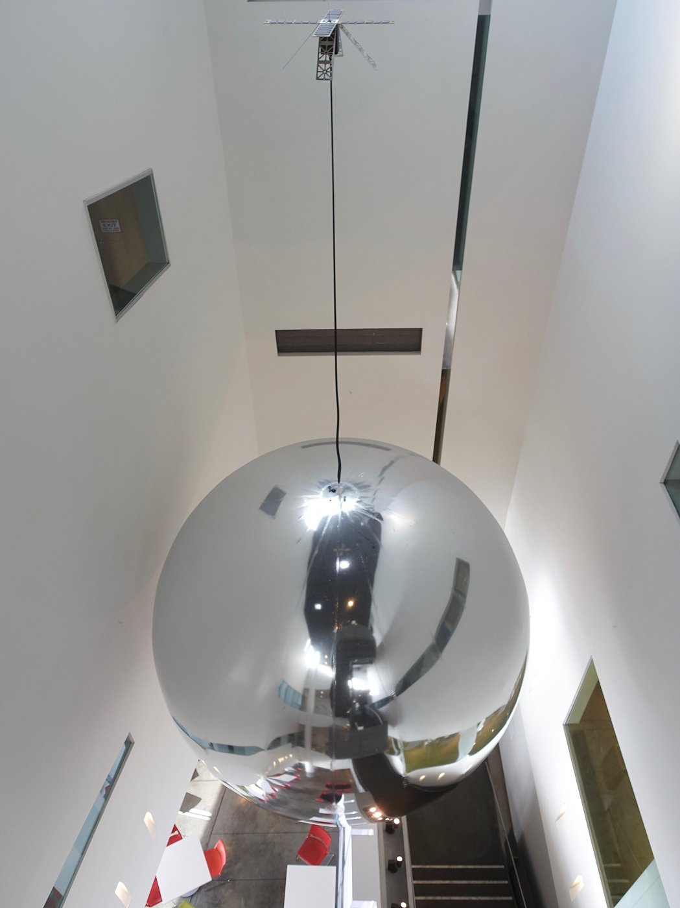

# Trevor Paglen

**Tag tecnica/formato:** `fotografia` `installazione` `data-visualization`
**Tag tema:** `sorveglianza-controllo` `intelligenza-artificiale-critica`
**Stato:** testo di sala della mostra «Strange Rules» (Venezia, 2026) tra le fonti · Approfondimenti aggiunti il 2026-11-01

## Biografia
Nato nel 1974 a Camp Springs, Maryland (USA), vive e lavora a Berlino. Formato sia come artista che come geografo (MFA all'Art Institute of Chicago, PhD in geografia, UC Berkeley), combina ricerca, giornalismo e tecnologie di imaging avanzate. MacArthur Fellowship 2017; Electronic Frontier Foundation Pioneer Award 2014 per il contributo alla contro-sorveglianza; Deutsche Börse Photography Foundation Prize 2016; LG Guggenheim Award 2026 ([paglen.studio](https://paglen.studio/bio/); [Ocula](https://ocula.com/artists/trevor-paglen/); [MacArthur Foundation](https://www.macfound.org/fellows/class-of-2017/trevor-paglen)).

## Poetica e ricerca
Paglen indaga i temi della segretezza, del militarismo e della politica della visibilità: le infrastrutture fisiche e planetarie di internet e del capitalismo dei dati, e i modi in cui i sistemi di machine learning ridefiniscono l'immagine e la percezione. Con la studiosa Kate Crawford ha sviluppato analisi critiche dei dataset di addestramento dell'intelligenza artificiale (*ImageNet Roulette*, *Excavating AI*). Ha scritto il saggio **"Operational Images"** (e-flux journal #59, 2014) che riprende e sviluppa il concetto di Harun Farocki — le immagini prodotte non per essere guardate ma per essere calcolate, misurate, usate per navigare o colpire un bersaglio — collegando esplicitamente la propria ricerca a quella del regista tedesco.

## Opere principali

### Voyager (2026, Strange Rules, Palazzo Diedo, Venezia; coprodotta con MAAT — Museum of Art, Architecture and Technology, Lisbona)
**Descrizione:** installazione audio interattiva che guida i partecipanti attraverso stati ipnotici, in cabine sensoriali private con sensori per il battito cardiaco e un menu di percorsi audioguidati (misticismo apofatico, deframmentazione neurologica, ipnosi ericksoniana). Caratteristica insolita per un'opera d'arte: non usa alcuna immagine.
**Lettura critica:** scommette che il linguaggio parlato, usato con precisione, possa funzionare come "codice eseguibile" per generare un mondo interiore — le immagini evocate ipnoticamente dall'inconscio del partecipante possono essere più immersive e toccanti di qualunque immagine mostrata direttamente. (Testo di sala, mostra "Strange Rules", Palazzo Diedo, Venezia, visitata 9 agosto 2026.)

⚠️ Nessuna immagine per coerenza con l'opera stessa, che non ne usa alcuna.

### The Last Pictures (2012–)
**Descrizione:** un disco di 100 immagini micro-incise, racchiuso in un guscio dorato, lanciato in orbita geostazionaria a bordo di un satellite per le telecomunicazioni — un archivio speculativo per spettatori futuri, ispirato alle pitture rupestri, ai segnali di avvertimento delle scorie nucleari e ai Golden Records di Carl Sagan.
**Lettura critica:** riflette sulla durata (le orbite geostazionarie possono restare stabili per miliardi di anni) e su cosa scegliere di comunicare a un futuro remoto e sconosciuto.

**Approfondimento:** [Creative Time — The Last Pictures](https://creativetime.org/projects/the-last-pictures/)

### Limit Telephotography / Blank Spots on the Map: The Dark Geography of the Pentagon's Secret World (2009, libro + serie fotografica)
**Descrizione:** immagini composite catturate con teleobiettivi lunghi fino a un miglio, che rivelano droni e "siti neri" (basi militari classificate, strutture di detenzione, società di facciata della CIA) altrimenti invisibili.
**Lettura critica:** rende visibile — letteralmente, tramite la tecnica fotografica — l'architettura nascosta del potere statale contemporaneo.

### ImageNet Roulette / Excavating AI (2019, con Kate Crawford)
**Descrizione:** progetto critico (sito web interattivo + saggio) che espone i bias razzisti, sessisti e classisti incorporati nei dataset di training usati per addestrare sistemi di visione artificiale, in particolare ImageNet.
**Lettura critica:** mostra come l'intelligenza artificiale non sia neutra: classifica il mondo secondo le categorie — spesso pregiudiziali — di chi ha costruito il dataset.

**Approfondimento:** [excavating.ai — saggio integrale](https://www.excavating.ai/)

### Autonomy Cube (2014, con Jacob Appelbaum)
**Descrizione:** scultura che ospita nei musei i nodi (*relay*) della rete Tor: i computer connessi al suo interno creano, ovunque sia installata, un hotspot Wi-Fi aperto chiamato «Autonomy Cube».
**Lettura critica:** porta un'infrastruttura di anonimato in rete dentro lo spazio espositivo, trasformando l'opera in un servizio per chi la visita.

**Approfondimento:** [Wikipedia — Trevor Paglen](https://en.wikipedia.org/wiki/Trevor_Paglen)

### Sight Machine (2017, con Kronos Quartet e Obscura Digital)
**Descrizione:** concerto del Kronos Quartet in cui alcune telecamere alimentano algoritmi di visione artificiale, dello stesso tipo di quelli usati nelle auto a guida autonoma e nei missili: dietro ai musicisti vengono proiettate le immagini che le macchine «vedono», con gli strumenti confrontati con immagini di riferimento tratte da dataset diffusi di apprendimento automatico. Presentato per la prima volta a San Francisco (Pier 70) il 14 gennaio 2017, in occasione della fiera FOG Design+Art; commissionato dal Cantor Arts Center (Stanford) nell'ambito della residenza dell'artista.
**Lettura critica:** mostra concretamente cosa sia un'immagine che non è fatta per essere guardata da una persona (il tema delle «immagini operative»).

**Approfondimento:** [Artforum — Trevor Paglen on surveillance, AI and his new work](https://www.artforum.com/columns/trevor-paglen-talks-about-surveillance-ai-and-his-new-work-235025/); [Stanford — Cantor Arts Center](https://museum.stanford.edu/node/243); [Barbican — crediti](https://www.barbican.org.uk/sites/default/files/documents/2019-07/Credits.pdf)

### A Study of Invisible Images (2017)
**Descrizione:** mostra personale alla Metro Pictures di New York (settembre-ottobre 2017), in cui confluisce il lavoro di *Sight Machine*.

**Approfondimento:** [Artviewer](https://artviewer.org/?p=101674)

### Orbital Reflector (2018)
**Descrizione:** progetto con il Nevada Museum of Art per mettere in orbita terrestre bassa un satellite riflettente e non funzionale, in materiale simile al Mylar, senza scopo militare, scientifico o commerciale. Lanciato il 3 dicembre 2018. Le fonti sono discordanti sull'esito: una lo descrive come entrato in orbita, un'altra come perso nello spazio, anche a causa dei ritardi nelle comunicazioni legati al blocco delle attività governative statunitensi all'inizio del 2019.

**Approfondimento:** [Galerie — Orbital Reflector](https://galeriemagazine.com/trevor-paglen-orbital-reflector/); [Sky & Telescope](https://skyandtelescope.org/astronomy-news/spacecraft-and-space-missions/spacex-orbiting-sculpture/); [Artnet](https://news.artnet.com/art-world/trevor-paglen-orbital-reflector-lost-space-1533073)

## Approfondimenti
Materiale per la didattica, aggiunto il 2026-11-01. I saggi con link sono stati letti sulla fonte, salvo dove è indicato il contrario.

### Parole dell'artista
- **«Operational Images» (2014).** Il saggio parte dalla prima visione di *Eye/Machine III* di Farocki al Pacific Film Archive: frecce animate e riquadri verdi di cui non capisce il senso. La tesi: le immagini ormai fanno cose nel mondo, guidano missili, seguono oggetti, e la funzione ha superato la visibilità. Le immagini operative sono sempre più invisibili, perché le macchine raramente ne producono una versione leggibile per le persone: da qui il compito degli artisti di continuare a esporle ([e-flux journal #59](https://www.e-flux.com/journal/59/61130/operational-images/)).
- **«Invisible Images» (2016).** La cultura visiva si è staccata dall'occhio umano: la gran parte delle immagini è fatta da macchine per altre macchine, e un file digitale può essere elaborato senza essere mai mostrato. Lettori di targhe, telecamere nei negozi, foto sui social usate per addestrare il riconoscimento facciale. Le macchine lavorano per astrazioni matematiche, quindi concetti classici come rappresentazione e ambiguità descrivono male ciò che accade. La sintesi è una frase: «We no longer look at images—images look at us» ([The New Inquiry](https://thenewinquiry.com/invisible-images-your-pictures-are-looking-at-you/)).
- **Niente contromisure facili.** Nello stesso saggio Paglen è scettico sulle tattiche visive: le immagini avversarie finiscono assorbite nei dati di addestramento futuri. Propone invece spazi deliberatamente inefficienti, fuori dalla cattura del mercato e della politica.

### Letture critiche e concetti
- **Il limite della mostra (Burke).** Recensendo *A Study of Invisible Images*, Sarah Burke sostiene che le opere attenuano la minaccia: personificare le macchine nasconde le persone e le aziende che le costruiscono e ne traggono profitto, e il romanticismo delle immagini smorza il disagio delle spiegazioni tecniche. La domanda su chi usa questi sistemi, e perché, resta senza risposta ([Hyperallergic, 2017](https://hyperallergic.com/trevor-paglen-metro-pictures)).
- **Il libro del 2026 (Hromack).** *How to See Like a Machine: Images After AI* (Verso, 2026) raccoglie saggi scritti in circa quindici anni. Sarah Hromack ne riconosce l'autorevolezza, ma nota che i saggi a volte si perdono nei dettagli e che alcuni esempi sono datati ([Brooklyn Rail, 2026](https://brooklynrail.org/2026/07/art_books/trevor-paglen-how-to-see-like-a-machine-images-after-ai/)).
- **Il legame con Farocki.** Vedi la scheda di Farocki per la genealogia dell'immagine operativa e per il problema della complicità, che vale anche per Paglen: mostrare un'immagine non fatta per essere vista la disattiva o la rende bella?

### Per la didattica
- Discussione: Paglen rende belle le immagini di cui parla? Mettere a confronto Burke con *Sight Machine*.
- Confronto con Zach Blas: l'opacità come tattica contro la cattura biometrica e lo scetticismo di Paglen sulle contromisure visive.
- Far leggere i primi paragrafi di *Invisible Images* e cercare in classe un esempio di immagine mai vista da nessuno.

### Da leggere
Non letti in questa revisione: Julian Stallabrass, «Negative Dialectics in the Google Era: A Conversation with Trevor Paglen», *October* 138, 2011, pp. 3-14; il testo integrale di [Excavating AI](https://www.excavating.ai/) con Kate Crawford.

## Interviste e talk
- **Video:** [Louisiana Channel — Trevor Paglen Interview: Moving Through the Night Sky](https://vimeo.com/288119571)
- [MCA Chicago — Talk: Trevor Paglen (luglio 2018)](https://mcachicago.org/Calendar/2018/07/Talk-Trevor-Paglen)
- [SSENSE — «The Artist Trevor Paglen, the Surveillance State, and Your Life»](https://www.ssense.com/en-it/editorial/art/this-artist-the-military-industrial-complex-and-your-life)

## Fonti
- [paglen.studio](https://paglen.studio/bio/)
- [The New Inquiry — «Invisible Images (Your Pictures Are Looking at You)» (2016)](https://thenewinquiry.com/invisible-images-your-pictures-are-looking-at-you/)
- [Hyperallergic — Sarah Burke su *A Study of Invisible Images* (2017)](https://hyperallergic.com/trevor-paglen-metro-pictures)
- [Brooklyn Rail — Sarah Hromack su *How to See Like a Machine* (2026)](https://brooklynrail.org/2026/07/art_books/trevor-paglen-how-to-see-like-a-machine-images-after-ai/)
- [Ocula — biografia](https://ocula.com/artists/trevor-paglen/)
- [MacArthur Foundation — Trevor Paglen](https://www.macfound.org/fellows/class-of-2017/trevor-paglen)
- [Pace Gallery — pagina artista](https://www.pacegallery.com/artists/trevor-paglen/)
- [Trevor Paglen — "Operational Images" (e-flux journal #59)](https://www.e-flux.com/journal/59/61130/operational-images/)
- Testo di sala, "Strange Rules", Palazzo Diedo, Venezia (foto scattata dal docente, 9 agosto 2026)

## Mostre viste
- *Strange Rules*, Palazzo Diedo, Venezia (2026) — visto da @danMa-hub

## Crediti delle immagini
Immagine per tre delle quattro opere, inclusa sotto la relativa descrizione in "Opere principali", da Creative Time, Wikimedia Commons ed excavating.ai. Nessuna immagine per *Voyager*, opera che non ne usa alcuna per propria natura.
- [paglen.com](https://paglen.com/)
- [Ocula — biografia](https://ocula.com/artists/trevor-paglen/)
- [MacArthur Foundation — Trevor Paglen](https://www.macfound.org/fellows/class-of-2017/trevor-paglen)
- *A Study of Invisible Images*: immagine dalla pagina [artviewer.org](https://artviewer.org/?p=101674); diritti dei rispettivi titolari, uso didattico.
- *Orbital Reflector*: foto di Steve Jurvetson from Los Altos, USA, [CC BY 2.0](https://commons.wikimedia.org/wiki/File:Trevor_Paglen%E2%80%99s_Orbital_Reflector,_a_huge_satellite_balloon_(35700576933).jpg), via Wikimedia Commons.
- *Sight Machine*: immagine dalla pagina [www.artforum.com](https://www.artforum.com/columns/trevor-paglen-talks-about-surveillance-ai-and-his-new-work-235025/); diritti dei rispettivi titolari, uso didattico.
