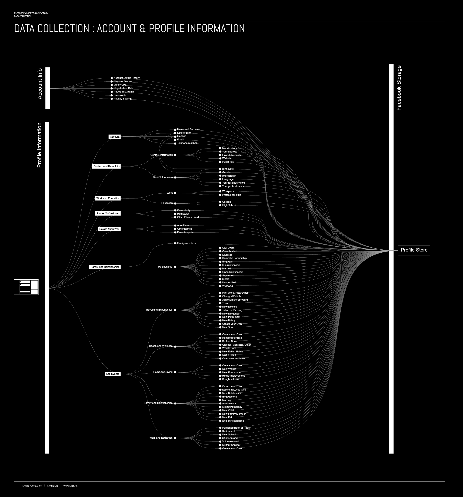
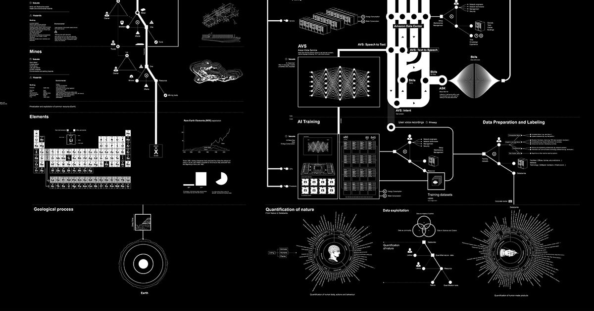
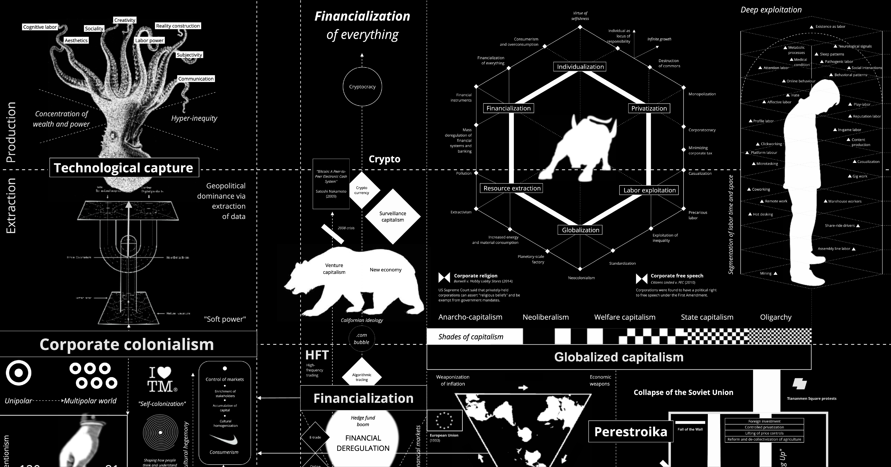
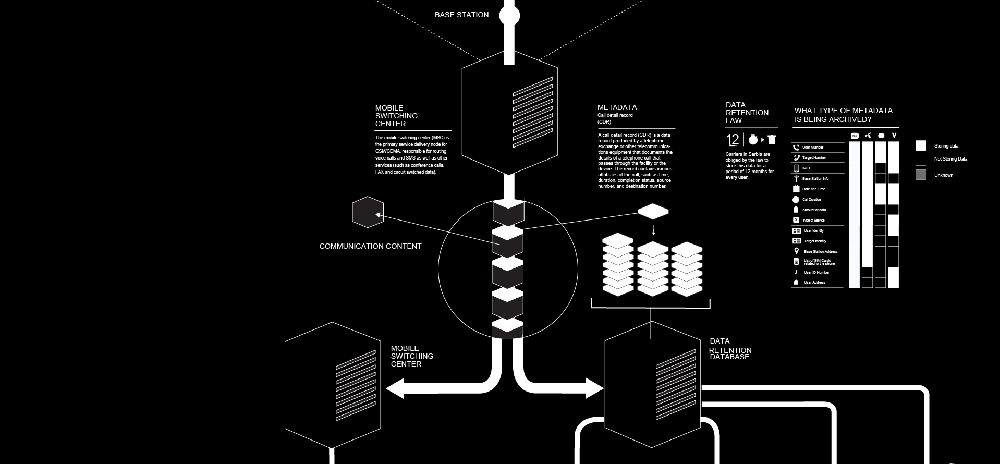

# Vladan Joler

**Tag tecnica/formato:** `data-visualization` `installazione`
**Tag tema:** `sorveglianza-controllo` `capitalismo-lavoro` `intelligenza-artificiale-critica`
**Tag corso:** `M3D`

## Biografia
Nato nel 1977 a Novi Sad, in Serbia (allora Jugoslavia), dove vive e lavora tuttora. Professore di New Media all'Accademia di Belle Arti dell'Università di Novi Sad. Fondatore e direttore di **SHARE Lab**, laboratorio di ricerca e data investigation, e co-fondatore di **SHARE Foundation**, organizzazione no-profit per i diritti digitali con sede a Novi Sad, nata nel 2012 a partire dalle SHARE Conference tenute a Belgrado (2011-12) e Beirut (2012). Ha un background radicato nell'attivismo mediatico e nell'hacking di videogiochi, e ha curato incontri di attivisti, artisti e ricercatori di internet prima di formalizzare SHARE Lab. Il suo lavoro è entrato nelle collezioni permanenti di MoMA (New York), Victoria & Albert Museum e Design Museum (Londra), Ars Electronica Center (Linz), ed è stato mostrato in oltre 100 esposizioni internazionali, incluso il Parlamento Europeo. Riconoscimenti principali: menzione d'onore al S+T+ARTS Prize 2019 e vincitore assoluto del Beazley Designs of the Year 2019 (Design Museum, Londra) per *Anatomy of an AI System*; Grand Prize S+T+ARTS 2024 e Leone d'Argento alla Biennale Architettura di Venezia 2025 per *Calculating Empires* — premio che Joler ha dedicato ai manifestanti anti-governativi serbi.

## Poetica e ricerca
Joler definisce il proprio metodo come **"cartografia critica"** (o "contro-cartografia"): lavora, nelle sue stesse parole, "da una posizione diversa — da qualcuno all'esterno della scatola nera, che cerca di comprendere tutti gli strati invisibili di strutture, tecnologia e relazioni di potere". La cartografia critica è per lui "un metodo per esaminare, esplorare e pensare le relazioni tra tecnologia e potere, non solo per documentarle e visualizzarle ma anche come cassetta degli attrezzi che permette di ripensare i concetti e i significati sottostanti". La sua pratica combina data investigation, contro-cartografia, giornalismo investigativo, scrittura, visualizzazione dei dati e design critico, applicati a temi come la trasparenza algoritmica, lo sfruttamento del lavoro digitale, le infrastrutture invisibili e le "scatole nere" tecnologiche: le sue grandi mappe diagrammatiche funzionano insieme come output di ricerca investigativa e come opera esposta. Il libro *Black Box Cartography: A Critical Cartography of the Internet and Beyond* (Institute of Network Cultures, 2023) raccoglie quattro delle sue mappe principali — *Facebook Algorithmic Factory*, *Anatomy of an AI System*, *Nooscope Manifested*, *New Extractivism* — come rassegna complessiva del metodo.

## Opere principali

### Facebook Algorithmic Factory (2016, SHARE Lab)
**Descrizione:** prima parte di una trilogia investigativa di SHARE Lab (le altre due: *Human Data Banks and Algorithmic Labour*, *Quantified Lives on Discount*) che mappa come Facebook converta l'attività degli utenti in dati monetizzabili — un lavoro immateriale, secondo Joler, svolto gratuitamente da oltre un miliardo di utenti profilati, che genera ricchezza concentrata nei proprietari della piattaforma.
**Lettura critica:** una delle prime cartografie critiche a rendere visibile, con il rigore di un'indagine giornalistica, l'architettura di estrazione dei dati dietro l'interfaccia apparentemente gratuita dei social network.

**Approfondimento:** [SHARE Lab — Facebook Algorithmic Factory](https://labs.rs/en/facebook-algorithmic-factory-immaterial-labour-and-data-harvesting/)

### Anatomy of an AI System (2018, con Kate Crawford)
**Descrizione:** diagramma "esploso" e saggio di accompagnamento che mappano nascita, vita e morte di un singolo dispositivo Amazon Echo lungo tre registri estrattivi — risorse materiali (estrazione mineraria di terre rare, logistica), lavoro umano (dalle miniere ai magazzini ai call center) e dati (i flussi raccolti da Alexa). Visualizza l'IA non come software ma come infrastruttura industriale ed estrattiva su scala planetaria.
**Lettura critica:** entrata nelle collezioni permanenti di MoMA e V&A, l'opera ha vinto il Beazley Designs of the Year 2019 (premio assoluto) e una menzione d'onore al S+T+ARTS Prize — riconoscimento istituzionale raro per un lavoro nato come indagine open-access piuttosto che come oggetto da mercato dell'arte.
**Video:** [Anatomy of an AI System, presentazione (YouTube)](https://www.youtube.com/watch?v=i_EZwV6wGP0)

**Approfondimento:** [anatomyof.ai — progetto ufficiale](https://anatomyof.ai/)

### The Nooscope Manifested: AI as Instrument of Knowledge Extractivism (2020, con Matteo Pasquinelli)
**Descrizione:** grande cartografia diagrammatica in forma di "manifesto" sui limiti tecnici ed epistemici del machine learning, pubblicata anche come articolo peer-reviewed sulla rivista *AI & Society* (Springer). Posiziona una critica alla pretesa dell'IA di possedere un'"intelligenza" autonoma, sganciata dal lavoro, dai dati e dal lavoro di classificazione umano da cui in realtà dipende.
**Lettura critica:** rara nel panorama della critica all'IA per l'unione di rigore accademico (pubblicazione peer-reviewed) e forma visiva immediatamente leggibile anche fuori dal contesto accademico.

### New Extractivism: An Assemblage of Concepts and Allegories (2020-2021)
**Descrizione:** grande mappa accompagnata da un manuale illustrato (con note a piè di pagina) che intreccia ricerca sul data mining, filosofia, teoria dei media, sociologia e narrativa per rappresentare l'"estrattivismo" come logica unificante che collega colonialismo delle risorse naturali, estrazione di dati ed estrazione di lavoro cognitivo/affettivo umano. Animazione video di Živa Stanojević e Aleksandar Ilić.
**Lettura critica:** condivide le fondamenta di ricerca con il libro di Kate Crawford *Atlas of AI* (Yale University Press, 2021) — due output distinti che nascono dalla stessa indagine sull'infrastruttura materiale dell'intelligenza artificiale.

⚠️ Nessuna immagine trovata con attribuzione certa in questa sessione.

### Calculating Empires: A Genealogy of Technology and Power, 1500-2025 (2023, con Kate Crawford)
**Descrizione:** mappa dittica di grande formato (circa 24 metri secondo le fonti) accompagnata da due volumi manoscritti annotati, che ripercorre cinque secoli di intreccio tra sistemi tecnologici e potere imperiale/statale, dalla stampa e il telegrafo fino all'intelligenza artificiale contemporanea. Presentata in anteprima all'Osservatorio della Fondazione Prada, Milano (2023-24); in seguito al KW Institute for Contemporary Art di Berlino, al Rijksmuseum Twenthe e alla Kunsthalle Wien.
**Lettura critica:** vincitrice del Grand Prize S+T+ARTS 2024 e del Leone d'Argento alla Biennale Architettura di Venezia 2025 — la scala storica di cinque secoli sposta il metodo della cartografia critica dall'analisi di un singolo sistema tecnico (l'Echo, Facebook) a una genealogia di lunghissimo periodo del potere tecnologico.

**Approfondimento:** [calculatingempires.net — progetto ufficiale](https://calculatingempires.net/)

### Invisible Infrastructures — sorveglianza di Stato in Serbia (dal 2014, SHARE Lab/SHARE Foundation)
**Descrizione:** indagine basata su richieste di accesso agli atti (FOIA) sul modo in cui i principali operatori di telecomunicazione serbi hanno concesso a organi statali accesso diretto e indipendente ai metadati delle comunicazioni conservati, aggirando l'obbligo di ordine giudiziario stabilito dalla Corte costituzionale serba nel 2013. Parte della serie più ampia "Invisible Infrastructures" del laboratorio, che comprende anche mappature dei flussi di dati.
**Lettura critica:** dimostra come il metodo di Joler non si applichi solo alle grandi piattaforme globali ma anche, con lo stesso rigore investigativo, al contesto politico locale serbo — coerente con le sue recenti prese di posizione pubbliche sulla crescente sorveglianza di Stato in Serbia.

**Approfondimento:** [SHARE Lab — Invisible Infrastructures](https://labs.rs/en/invisible-infrastructures-surveillance-achitecture/)

## Immagini

Immagine per cinque delle sei opere, inclusa sotto la relativa descrizione in "Opere principali", da SHARE Lab, anatomyof.ai, calculatingempires.net e Fritz.ai. Nessuna immagine reperita con attribuzione certa per *New Extractivism*.
- [SHARE Lab](https://labs.rs/)
- [SHARE Foundation — chi siamo](https://sharefoundation.info/en/about-us/)
- [Anatomy of an AI System — progetto ufficiale](https://anatomyof.ai/)

## Fonti
- [SHARE Lab](https://labs.rs/)
- [SHARE Foundation — chi siamo](https://sharefoundation.info/en/about-us/)
- [Anatomy of an AI System — progetto ufficiale](https://anatomyof.ai/)
- [MoMA — collezione, Anatomy of an AI System](https://www.moma.org/collection/works/401279)
- [Victoria & Albert Museum — collezione, Anatomy of an AI System](https://collections.vam.ac.uk/item/O1500029/anatomy-of-an-ai-system-poster-kate-crawford/)
- [Fondazione Prada — Calculating Empires](https://www.fondazioneprada.org/project/calculating-empires/?lang=en)
- [Pasquinelli, Joler — "The Nooscope manifested", AI & Society (Springer, 2020)](https://link.springer.com/article/10.1007/s00146-020-01097-6)
- [Ars Electronica — S+T+ARTS Prize, Calculating Empires](https://ars.electronica.art/starts-prize/en/calculating-empires/)
- [Dezeen — Beazley Designs of the Year 2019](https://www.dezeen.com/2019/11/22/anatomy-of-an-ai-system-design-of-the-year-2019/)
- [Institute of Network Cultures — Black Box Cartography (2023)](https://networkcultures.org/blog/2023/10/16/black-box-cartography/)
- [Balkan Insight — profilo e intervista (2025)](https://balkaninsight.com/2025/05/21/not-normal-acclaimed-professor-decries-the-rise-of-surveillance-in-serbia/)

---

## Appunti da organizzare
- Citato in *Applicazioni digitali per l'arte* e in *Tecniche di animazione digitale (Triennio)*, insieme a Rosa Menkman, Metahaven, Hito Steyerl, Jon Rafman, nell'ambito della critica all'economia dell'attenzione e delle infrastrutture di estrazione dati.
- ⚠️ Non confermati: opere con i titoli "Pain Cartography" o una collaborazione con un "Al Jazeera Data Team" — non risultano da nessuna fonte trovata, da non includere senza conferma diretta. Rango accademico esatto (professore ordinario vs. associato) da verificare sul sito dell'Università di Novi Sad. Nessun Golden Nica di Ars Electronica confermato — i riconoscimenti verificati sono S+T+ARTS Prize (menzione 2019, Grand Prize 2024), Beazley Designs of the Year 2019 e Leone d'Argento 2025.
- Video: [CUMULUS Budapest 2024, keynote "New Extractivism"](https://www.youtube.com/watch?v=dHiDmeu7Zpg); [documentazione video di Nooscope Manifested (Vimeo)](https://vimeo.com/418823251).
- Il sito personale (joler.org) non è stato raggiungibile direttamente per restrizioni di rete durante la ricerca — da consultare di persona come fonte primaria di controllo.
