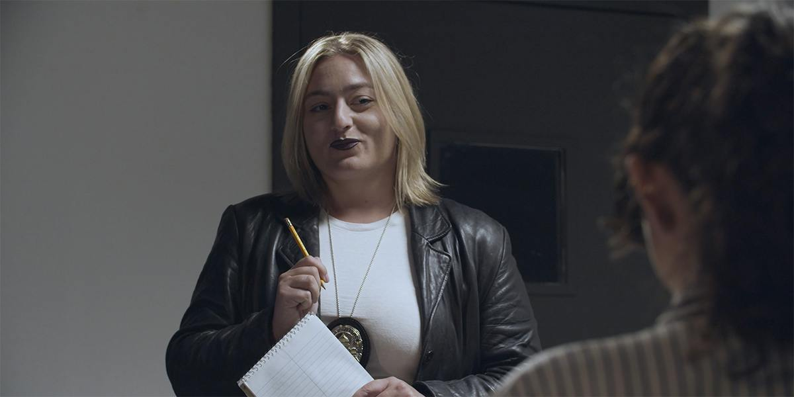
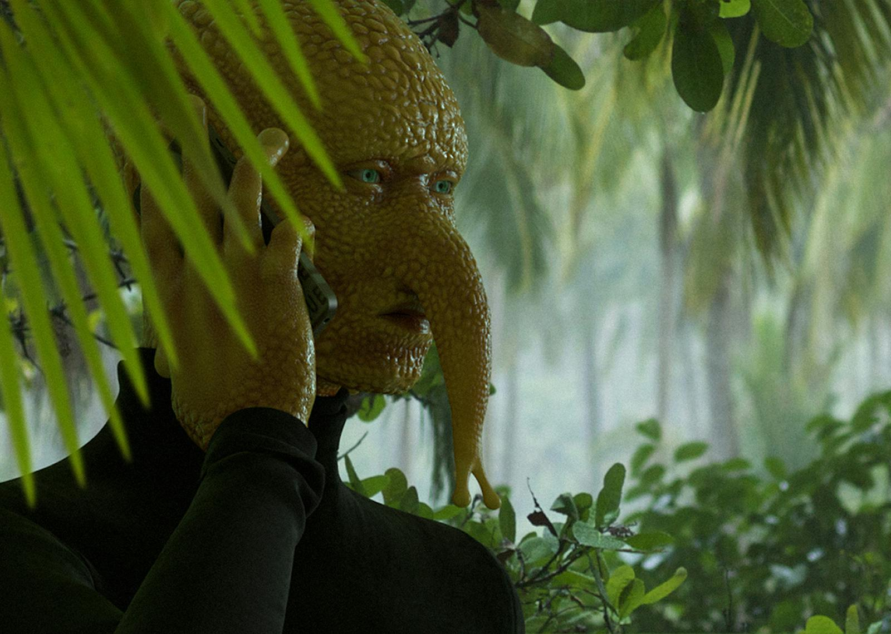
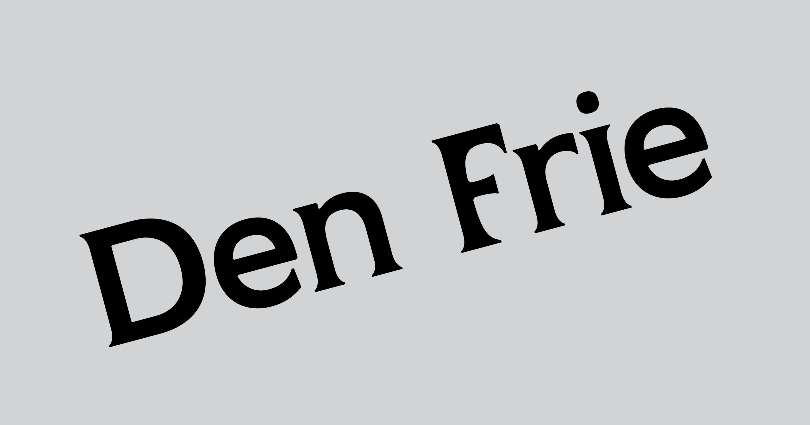

# Will Benedict e Steffen Jørgensen

**Tag tecnica/formato:** `video` `installazione`
**Tag tema:** `economia-attenzione` `ecologia-ambiente`
**Stato:** scheda parziale, scritta a partire da fonti web (Wikipedia, siti di festival e gallerie); non è documentato come sono realizzati gli episodi (nessuna fonte parla di 3D o di animazione) · non ancora assegnata a un corso · immagini da verificare (diritti degli autori)

## Biografia
Will Benedict è nato nel 1978 a Los Angeles e vive a Parigi. Ha studiato all'Art Center College of Design di Pasadena (1999-2004) e alla Städelschule di Francoforte (2004-2006). Tra le mostre personali: *Corruption Feeds* (Bergen Kunsthall, 2014), *The Social Democrat* (Gio Marconi, Milano, 2017), *Dialogue of the Dogs* (Centre d'Art Contemporain Genève, 2022), *Pandemonium* (performance musicale, Bourse de Commerce, Parigi, 2023), *Hello Greedy Citizens* (Balice Hertling, Parigi, 2025). Steffen Jørgensen, danese, si è diplomato alla Funen Art Academy nel 2009 e ha studiato all'Akademie der bildenden Künste di Vienna. Lavorano insieme a *The Restaurant* da circa otto anni.

## Poetica e ricerca
*The Restaurant* è una serie video in corso, mostrata a episodi in contesti espositivi diversi e pubblicata su dis.art, in cui personaggi umani e non umani cucinano e servono cibo l'uno all'altro, cercano un senso e non riescono a essere membri utili della società. La lettura critica italiana vi vede una satira del consumo: il cibo come «prodotto-merce», la cultura gastronomica che alimenta la speculazione con programmi televisivi, concorsi e festival, la tecnologia e i sistemi «smart» che orientano il modo di mangiare, e l'apatia a cui la serie promette come cura la «food-experience».

## Opere principali

### The Restaurant, stagione 1 (dal 2018, dis.art)
**Descrizione:** Serie di sei episodi su dis.art (nell'elenco della serie risultano ad accesso riservato): *The Average Chef*, *Mother*, *Sugar is Coke*, *Le Suicide*, *Degrees of Disgust*, *No More Tuna in the Tuna Sandwiches*. L'ambientazione è un grattacielo di soli ristoranti, gestito da migliaia di cuochi di molte specie, che sorge dalla nebbia di una foresta pluviale; il tono è quello di un cooking show del XXI secolo, con piatti come auto della polizia sott'aceto e «ketchup di sangue». Nel primo episodio il protagonista, «il cuoco medio», impara dai tutorial di YouTube, compra gli ingredienti da una creatura mezza lumaca e mezza umana (Monsieur Bulot, o Snailien) e cerca di battere il rivale Café Wha?. *Mother* è dedicato al lato oscuro della pizza; *No More Tuna* è descritto come un anti-ASMR porcino. *Degrees of Disgust* è stato proiettato anche al Centre d'Art Contemporain Genève nel 2019.

⚠️ Nessuna immagine trovata.

### The Restaurant (Converso, Milano, 2018)
**Descrizione:** Prima presentazione, nell'ex chiesa di San Paolo Converso a Milano (marzo-aprile 2018, a cura di Steve Kado). Un video centrale mostra un cuoco che cucina guidato da Siri in un mondo distopico; lo spazio è allestito come un «universo-stomaco»: una scrivania spoglia, lampade antropomorfe, un pavimento a specchio e un forno a microonde in cui passa il video di una testa aliena. Il cuoco prende le verdure da Snailien e gareggia con il rivale Café Wha? attraverso una ricetta dopo l'altra.
**Lettura critica:** Letta da ATP Diary come favola in cui è il corpo a muovere il cibo; da un'altra recensione come mondo-stomaco che riceve, trasforma e rigetta il cibo.

⚠️ Nessuna immagine trovata.

### The Restaurant, stagione 2 (2021)
**Descrizione:** Tre episodi su dis.art: *The Rainforest Inside Us*, *The First Fat* e *Blueberry World*, coprodotti dal Centre d'Art Contemporain Genève per la Biennale de l'Image en Mouvement 2021. Nel centro della stagione c'è Café Wha?, che funziona anche da sala interrogatori: la conduttrice Casey Jane Ellison interpreta gastroenterologa, detective e terapeuta e interroga i «sospetti» sulle loro abitudini alimentari. Un podcast scientifico, condotto da Earface e Blue Chicken (un pollo blu quasi umano e un uomo con orecchie al posto degli occhi) davanti a un pubblico di animali da fattoria, affronta microbioma, origine del grasso e come sarebbe la vita su un pianeta fatto di soli mirtilli. In *The First Fat* si discute dell'origine del grasso prima ancora degli esseri senzienti («Without fat, there would be no Us»). In *The Rainforest Inside Us* ci si chiede se «food anxiety» sia la nuova prigione che ci costruiamo, e se il legame cervello-intestino-microbiota sia il nuovo SSRI.

### The Restaurant Season 2 (Den Frie, Copenaghen, 2024-2025)
**Descrizione:** Mostra personale (5 ottobre 2024 - 19 gennaio 2025, a cura di Magnus Thorø Clausen). Il racconto è ambientato nelle rovine di un grattacielo parigino circondato dalla giungla; tra i personaggi ricorrenti: una luna malinconica, un T-rex in un bagno all'aperto, uno spaventapasseri senza diritti e un fattorino mezzo umano e mezzo lumaca.

⚠️ Nessuna immagine trovata.

## Fonti
- [dis.art — The Restaurant](https://dis.art/series/the-restaurant)
- [dis.art — The Rainforest Inside Us](https://dis.art/the-rainforest-inside-us)
- [dis.art — The Average Chef](https://dis.art/the-average-chef)
- [dis.art — The First Fat](https://dis.art/the-first-fat)
- [Den Frie — The Restaurant Season 2](https://denfrie.dk/en/exhibition/the-restaurant-season-2/)
- [ATP Diary — The Restaurant (Converso, Milano)](http://atpdiary.com/will-benedict-steffen-jorgensen-the-restaurant-converso-milano/)
- [Forme Uniche — Il mondo-stomaco di Will Benedict e Steffen Jorgensen](http://formeuniche.org/will-benedict-steffen-jorgensen-the-restaurant/)
- [Meyer Kainer — Will Benedict](https://meyerkainer.com/artist/will-benedict/?template=biography)
- [Art Hub Copenhagen — Steffen Jørgensen movie night](https://arthubcopenhagen.net/en/event/steffen-jorgensen-movie-night)
- [Vimeo — The Restaurant [INTRO]](https://vimeo.com/250164426)

## Crediti delle immagini
Immagini da verificare: provengono da pagine di festival, gallerie, siti degli artisti e piattaforme, e restano di proprietà degli autori.
- The Rainforest Inside Us (1): [dis.art](https://dis.art/the-rainforest-inside-us) · Immagine promozionale / fotogramma ufficiale, diritti degli autori; uso didattico
- The Rainforest Inside Us (2): [dis.art](https://dis.art/series/the-restaurant) · Immagine promozionale / fotogramma ufficiale, diritti degli autori; uso didattico
- The Rainforest Inside Us (3): [denfrie.dk](https://denfrie.dk/en/exhibition/the-restaurant-season-2/) · Immagine promozionale / fotogramma ufficiale, diritti degli autori; uso didattico
