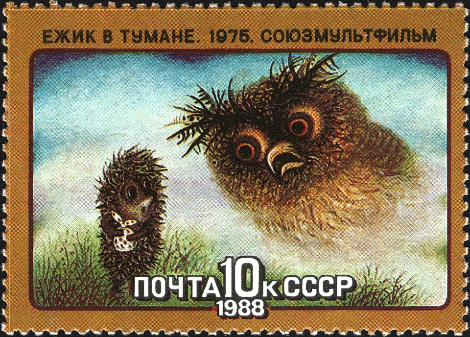

# Yuri Norstein

**Tag tecnica/formato:** `animazione-2d`
**Tag tema:** `memoria-archivio`
**Stato:** scheda parziale, scritta a partire da fonti web (Wikipedia, siti di festival e gallerie); non ancora assegnata a un corso · immagini da verificare (diritti degli autori)

## Biografia
Nato il 15 settembre 1941, animatore russo. Lavora allo studio sovietico Soyuzmultfilm di Mosca. Dal 1981 lavora a un lungometraggio tratto dal racconto *Il cappotto* di Gogol; secondo il *Washington Post* è considerato da molti il migliore animatore della sua epoca e di sempre.

## Poetica e ricerca
Le sue opere più note sono realizzate in collaborazione con la moglie, l'artista Francheska Yarbusova.

## Opere principali

### Hedgehog in the Fog (Ёжик в тумане, 1975)
**Descrizione:** Cortometraggio d'animazione sovietico prodotto da Soyuzmultfilm; sceneggiatura russa di Sergei Kozlov, autore anche dell'omonimo libro. Nel 2006 Norstein pubblica un libro con lo stesso titolo.

### Tale of Tales
**Descrizione:** Cortometraggio realizzato insieme alla moglie Francheska Yarbusova.

⚠️ Nessuna immagine trovata.

## Fonti
- [Wikipedia — Yuri Norstein](https://en.wikipedia.org/wiki/Yuri_Norstein)
- [Wikipedia — Hedgehog in the Fog](https://en.wikipedia.org/wiki/Hedgehog_in_the_Fog)

## Crediti delle immagini
Immagini da verificare: provengono da pagine di festival, gallerie, siti degli artisti e piattaforme, e restano di proprietà degli autori.
- Hedgehog in the Fog (Ёжик в тумане) (1): [en.wikipedia.org](https://en.wikipedia.org/wiki/File%3AThe_Soviet_Union_1988_CPA_5919_stamp_%28Hedgehog_in_the_Fog%29.jpg) · Public domain
