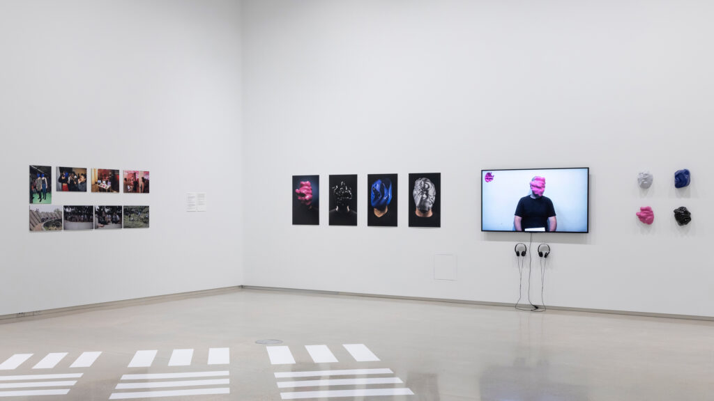
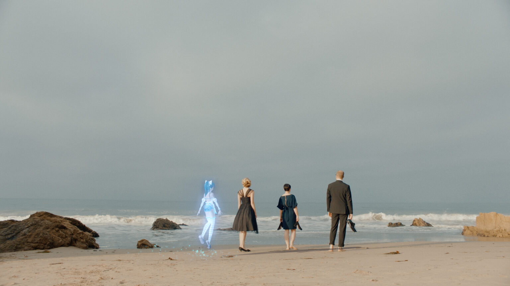
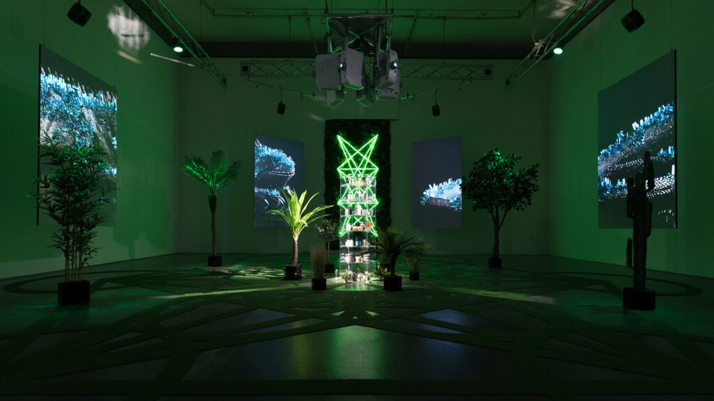

# Zach Blas

**Tag tecnica/formato:** `stampa-3d-scultura` `installazione` `video`
**Tag tema:** `sorveglianza-controllo` `genere-queerness`
**Tag corso:** `TAD-DCV` `TAD-AVM` `M3D`
**Stato:** biografia e descrizioni di *Contra-Internet: Jubilee 2033* e *The Doors* corrette sul sito dell'artista il 2026-11-01 · tolto *Biometric Mirror*, opera di altri autori (vedi Approfondimenti) · Glissant e Foucault verificati su *Informatic Opacity*; Zuboff e Deleuze non ancora

## Biografia
Nato nel 1981 a Point Pleasant, West Virginia. PhD in letteratura alla Duke University (2014). Dal 2021 insegna studi visivi alla University of Toronto, dove vive. Mostre tra cui la Biennale di Berlino (2022), la Biennale di Gwangju (2018), la Whitney Biennial (2026), personali alla Secession di Vienna (2024) e al Van Abbemuseum (2020). Tra i libri, *Unknown Ideals* (2021) e *Informatics of Domination* (curato con Melody Jue e Jennifer Rhee, 2025).[^1][^2]

## Poetica e ricerca
Blas indaga i presupposti ideologici e le implicazioni biopolitiche incorporate nel software, negli algoritmi e nei sistemi di riconoscimento biometrico, mostrando come la tecnologia funzioni da apparato normativo che classifica ed esclude le identità non conformi — in particolare queer, trans e razzializzate. La sua risposta non è la denuncia diretta, ma una contro-prassi estetica: strumenti, maschere e narrazioni speculative per resistere alla cattura algoritmica, rivendicando il **diritto all'opacità** (Édouard Glissant) contro la "tirannia della trasparenza" richiesta dal riconoscimento facciale.

## Opere principali

### Facial Weaponization Suite (2012-2014)
**Corso:** `M3D` `TAD-DCV`
**Temi:** `riconoscimento-facciale-biometria` `norma-e-standardizzazione`
**Descrizione:** serie di maschere fisiche amorfe, stampate in 3D a partire dai dati biometrici aggregati dei partecipanti ai workshop, indossate in performance documentate in video. La prima, *Fag Face Mask*, risponde alle ricerche che pretendono di ricavare l'orientamento sessuale dal volto.[^3]
**Lettura critica:** creando una "faccia collettiva" mostruosa, le maschere negano all'algoritmo un volto leggibile — un atto di opacità collettiva contro la logica biometrica dell'individuo normalizzato.
**Video:** [documentazione (Vimeo)](https://vimeo.com/76104217)

**Approfondimento:** [zachblas.info — Facial Weaponization Suite](https://zachblas.info/works/facial-weaponization-suite/)

### Contra-Internet: Jubilee 2033 (2018)
**Corso:** `TAD-AVM` `TAD-DCV`
**Temi:** `infrastruttura-e-rete`
**Descrizione:** video HD di 30 minuti e 52 secondi che rielabora scene di *Jubilee* (1978) di Derek Jarman. Nel 1955 Ayn Rand e i membri del suo Collective, tra cui Alan Greenspan, assumono acido e, guidati dall'intelligenza artificiale Azuma, viaggiano in una Silicon Valley futura in cui bruciano i campus di Apple, Facebook e Google e Rand è la filosofa di riferimento dei dirigenti tecnologici. In un ufficio occupato di Palantir incontrano Nootropix, profeta contra-sessuale e contra-internet interpretato da Cassils. Candidato al Teddy Award a Berlino nel 2018; prologo della trilogia *Silicon Traces*.[^4]
**Lettura critica:** l'internet non come spazio di liberazione ma come totalità da cui cercare un'uscita (vedi *Contra-Internet* in Approfondimenti). *Silicon Traces* indaga le storie, le credenze e le fantasie che fanno delle visioni del futuro della Silicon Valley uno strumento di dominio.

**Approfondimento:** [zachblas.info — Contra-Internet: Jubilee 2033](https://zachblas.info/works/contra-internet-jubilee-2033/)

### The Doors (2019)
**Corso:** `TAD-AVM` `M3D`
**Temi:** `avatar-e-corpo-virtuale`
**Descrizione:** installazione multimediale, prima parte della trilogia *Silicon Traces*: video HD a sei canali (41 minuti e 25 secondi, in loop), schermi a specchio nero, una sigla di erba artificiale, piante, neon e una raccolta di 65 nootropi. Un giardino artificiale a forma di cubo di Metatron ospita piante e paesaggi sonori di Myanmar, Hawaii, Baia di San Francisco e Mojave, e lucertole in CGI modellate sulla *Barbaturex morrisoni*. Una poesia parlata è generata da un'IA addestrata sulla letteratura aziendale dei nootropi e sugli scritti e la voce di Jim Morrison. Commissionata da Haus für Medienkunst, de Young Museum e Van Abbemuseum.[^5] La descrizione precedente, con Morrison che tiene un talk TED, non trova conferma nella pagina dell'opera ed è stata tolta.
**Lettura critica:** mette a confronto il motto degli anni Sessanta «turn on, tune in, drop out» con le «smart drugs» vendute nel settore tecnologico: i legami della Silicon Valley con la controcultura, dalla liberazione all'ottimizzazione.

**Approfondimento:** [zachblas.info — The Doors](https://zachblas.info/works/the-doors/)

## Approfondimenti
Materiale per la didattica, aggiunto il 2026-11-01. I due testi di Blas sono stati letti sulla fonte.

### Parole dell'artista
- **Opacità informatica.** Per Blas la sorveglianza digitale, rivelata dai programmi NSA nel 2013, ha sostituito il panottico di Foucault: il potere rende le persone visibili come dati aggregati, identificabili e classificabili. Seguendo Philip Agre chiama questa logica «cattura»: si misura ogni persona su modelli predefiniti, costruiti da esseri umani e quindi non neutri. L'opacità non è sparire, ma non emettere la luce che questi sistemi leggono: una pratica collettiva di evasione, come la protesta in maschera, la cifratura, l'arte (*Informatic Opacity*, Journal of Aesthetics and Protest 9;[^3] ripubblicato nel *Posthuman Glossary*, Bloomsbury, 2018).
- **Glissant, tatticamente.** Da Édouard Glissant viene il diritto all'opacità, che per lui è una posizione etica e ontologica contro la classificazione. Blas nota che Glissant non lo intende come tattica e sostiene che oggi debba diventarlo, perché la cattura minaccia l'opacità stessa.
- **Una queerness mutata.** L'opacità informatica è descritta come una queerness portata su scala tecnica e globale, sulla scia di Muñoz e Halberstam.
- **Il paradosso.** Essere illeggibili espone anche a violenza e criminalizzazione, come accade alle persone trans e senza documenti: la precarietà viene dall'opacità, eppure il desiderio di sfuggire alla visibilità resta.
- **Contra-Internet.** Internet è diventato una condizione socioculturale totale, come il capitalismo. Blas cerca un fuori con la «contrasessualità» di Paul Preciado come modello e con il «paranodo», lo spazio che le reti escludono; cita strumenti di rete a maglie come FireChat, usato nelle proteste di Hong Kong.[^6]

### Letture critiche e concetti
- **Altri esempi citati da Blas.** Le sciarpe WikiLeaks di Metahaven, il trucco CV Dazzle di Adam Harvey, le maschere di Jemima Wyman per le Pussy Riot.
- **Correzione: *Biometric Mirror*.** La scheda attribuiva a Blas quest'opera, descritta nel documento di origine AI. Il sito e la biografia dell'artista non la riportano: è un progetto del 2018 della University of Melbourne, guidato da Niels Wouters con la Science Gallery Melbourne e l'artista Lucy McRae.[^7] Il collegamento con la frenologia e con Zuboff veniva dallo stesso documento.

### Per la didattica
- Confronto con Adam Harvey (scheda nel database): maschera collettiva e trucco individuale.
- Confronto con Paglen: Blas propone tattiche di opacità, Paglen dubita delle contromisure visive perché finiscono nei dati di addestramento.
- Domanda per la classe: chi può permettersi di essere opaco? È il paradosso indicato da Blas.

### Da leggere
Non letti in questa revisione: [Lila Lee-Morrison, *Portraits of Automated Facial Recognition* (2019), estratto](https://zachblas.info/wp-content/uploads/2019/12/lila-lee-morrison_portraits-of-automated-facial-recognition_2019.pdf); [*Towards Computational Body Horror*](https://zachblas.info/wp-content/uploads/2023/07/Towards-Computational-Body-Horror.pdf).

## Interviste e talk
- **Video:** [Art, AI and Control Societies — talk, Walker Art Center (YouTube)](https://www.youtube.com/watch?v=FwT0hYyIe20)
- **Video:** [The Right to Be Opaque — talk, transmediale (YouTube)](https://www.youtube.com/watch?v=Pbcr-n1e-IA)
- [Vice — «Weaponizing Our Faces: An Interview with Zach Blas»](https://creators.vice.com/en/topic/zach-blas)
- [Hyperallergic — Alicia Eler, «The Facelessness of Tomorrow Begins Today» (2013, PDF)](https://zachblas.info/wp-content/uploads/2013/04/alicia-eler_the-facelessness-of-tomorrow-begins-today_hyperallergic_2013.pdf)
- [«Biometrics and Opacity»: una conversazione](https://zachblas.info/publications/biometrics-and-opacity-a-conversation/)
- [«California Dreamin'»: Zach Blas e Ana Teixeira Pinto in conversazione](https://zachblas.info/?p=5277)
- [Stedelijk Museum — lecture come visiting fellow 2025 (6 giugno 2025), sulla serie *Silicon Traces*](https://www.stedelijk.nl/en/events/zach-blas-visiting-fellow-en)
- [ICA Londra (2014) — conversazione con Jack Halberstam: «How I Learned to Stop Worrying and Queer the Internet»](https://archive.ica.art/node/38967)

## Fonti
- [zachblas.info — sito ufficiale](https://zachblas.info/)
- [Facial Weaponization Suite](https://zachblas.info/works/facial-weaponization-suite/)
- [Contra-Internet: Jubilee 2033 — trailer](https://vimeo.com/261314972)
- [Zach Blas, *Informatic Opacity*](https://joaap.org/issue9/zachblas.htm)
- [Zach Blas, *Contra-Internet*, e-flux journal #74 (2016)](https://www.e-flux.com/journal/74/59816/contra-internet/)

## Crediti delle immagini
Immagine per ciascuna delle tre opere, inclusa sotto la relativa descrizione in "Opere principali", dal sito ufficiale dell'artista. Il dominio zachblas.com citato nelle fonti originali non è più attivo: l'indirizzo corrente è zachblas.info.
- [zachblas.info — sito ufficiale](https://zachblas.info/)
- [Facial Weaponization Suite](https://zachblas.info/works/facial-weaponization-suite/)

[^1]: Biografia di Zach Blas, *zachblas.info*. [link](https://zachblas.info/bio/)

[^2]: Zach Blas, *CV*, 13 novembre 2025. Letta solo nell'estratto del motore di ricerca. [link](https://zachblas.info/wp-content/uploads/2025/11/ZachBlas_CV_13Nov2025.pdf)

[^3]: Zach Blas, «Informatic Opacity», *The Journal of Aesthetics and Protest*, 9; ripubblicato nel *Posthuman Glossary*, Bloomsbury, 2018. [link](https://joaap.org/issue9/zachblas.htm)

[^4]: Pagina di *Contra-Internet: Jubilee 2033*, *zachblas.info*. [link](https://zachblas.info/works/contra-internet-jubilee-2033/)

[^5]: Pagina di *The Doors*, *zachblas.info*. [link](https://zachblas.info/works/the-doors/)

[^6]: Zach Blas, «Contra-Internet», *e-flux journal*, 74, giugno 2016. [link](https://www.e-flux.com/journal/74/59816/contra-internet/)

[^7]: «Biometric Mirror highlights flaws in artificial intelligence», University of Melbourne, luglio 2018. Letta solo nell'estratto del motore di ricerca. [link](https://www.unimelb.edu.au/newsroom/news/2018/july/biometric-mirror-highlights-flaws-in-artificial-intelligence)
